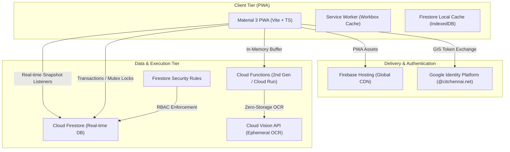
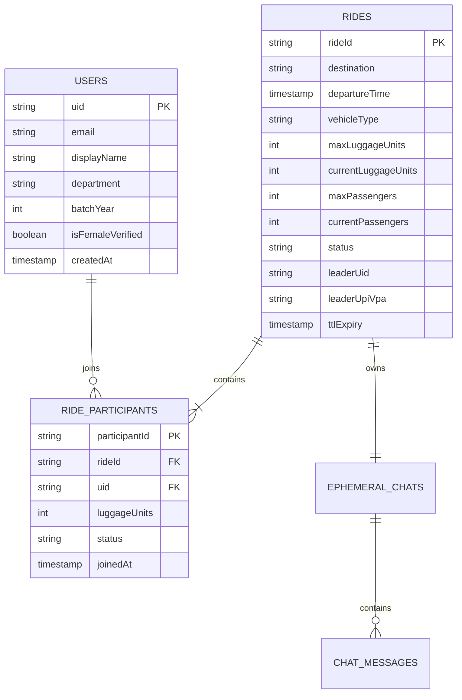
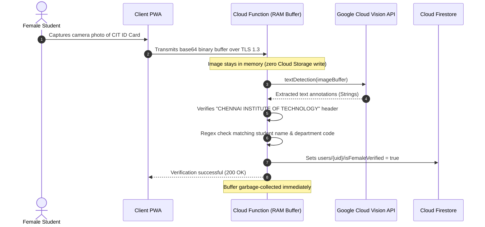

# CIT CabSync — System Architecture & Engineering Specification

**Document Control:** Production Engineering Specification  
**Project Target:** CIT Campus Transit Network  
**Ecosystem Alignment:** Google Cloud Platform (GCP) & Firebase Production Standards  
**Target Platform:** Mobile-First Progressive Web App (PWA)  

---

## 1. System Overview & Problem Constraints

Transit logistics between collegiate suburban campuses (e.g., Chennai Institute of Technology) and major metropolitan transit terminals (Tambaram, Kilambakkam, Egmore, Central) present recurring operational bottlenecks:

```
[CIT Campus] ───(Suburban Transit Bottleneck)───> [Tambaram / Kilambakkam / Egmore]
  │
  ├── Problem 1: Boot-space exhaustion (4 passengers with 4 hard-shell trolleys cannot fit in a sedan)
  ├── Problem 2: PII leakage (uncontrolled sharing of personal WhatsApp/phone numbers across student batches)
  ├── Problem 3: Payment friction (disputes over toll charges, cash change, and unequal split calculations)
  └── Problem 4: Safety verification for female students traveling late hours
```

CabSync resolves these bottlenecks through a deterministic luggage point allocation engine, ephemeral real-time match lobbies, domain-restricted Google Identity Platform authentication, and memory-only optical verification.

---

## 2. Google Ecosystem Technical Topology

The entire application runs strictly within the Google Cloud / Firebase ecosystem to minimize cold starts, achieve multi-region low-latency sync, and simplify infrastructure maintenance.



### Stack Matrix

| Layer | Technology | Selection Rationale |
| :--- | :--- | :--- |
| **Frontend Runtime** | Vite + TypeScript + Preact/React | Minimal bundle footprint (<80KB initial JS), instant time-to-interactive (TTI) on 4G cellular links. |
| **Design System** | Google Material Design 3 (M3) | Native Android feel, strict tokenized typography, elevation surfaces, accessible touch-targets (min 48x48dp). |
| **Hosting & CDN** | Firebase Hosting (HTTP/2 + Brotli) | Edge-cached static bundles, automated SSL, custom domain routing with single-command CLI rollout. |
| **Authentication** | Google Identity Services (GIS) | Restricted to `*@citchennai.net` domain via Firebase Auth blocking functions and client-side tenancy checks. |
| **Real-time Database** | Cloud Firestore | Real-time WebSocket subscriptions (`onSnapshot`), snapshot metadata latency compensation, offline cache. |
| **Backend Compute** | Cloud Functions for Firebase (2nd Gen) | Eventarc and HTTP triggers powered by Cloud Run; zero idle billing. |
| **Vision & Verification** | Google Cloud Vision API (Annotations) | Ephemeral optical document analysis executed strictly within RAM buffer without persisting images to Google Cloud Storage. |

---

## 3. Data Models & Concurrency Engine

### 3.1 Entity Relationship Model



### 3.2 Luggage Knapsack Point Allocation Matrix

Cab pooling typically fails because vehicles run out of boot space long before they run out of passenger seats. CabSync quantifies boot volume using an integer unit model:

* **1 Luggage Unit** = Standard backpack, laptop bag, or compact duffel (seats footwell or lap).
* **2 Luggage Units** = 20-24" medium hard-shell trolley suitcase (occupies dedicated boot volume).
* **3 Luggage Units** = 28"+ heavy international transit trunk (requires half of typical sedan boot).

#### Vehicle Maximum Capacities

| Vehicle Category | Max Passengers | Max Luggage Units | Standard Fleet Examples |
| :--- | :---: | :---: | :--- |
| **Auto Rickshaw** | 3 | **4 Units** | Bajaj Compact / TVS King |
| **Prime Sedan** | 4 | **7 Units** | Swift Dzire, Toyota Etios, Hyundai Aura |
| **Prime SUV / XL** | 6 | **10 Units** | Maruti Ertiga, Toyota Innova Crysta |

### 3.3 Atomic Ride Reservation Transaction (TypeScript)

To eliminate race conditions when multiple students attempt to claim the final passenger slot or luggage unit concurrently, ride booking operations execute inside a strict Firestore Transaction:

```typescript
import { getFirestore, runTransaction, doc, serverTimestamp, increment } from "firebase/firestore";

interface JoinRideRequest {
  rideId: string;
  userUid: string;
  luggagePoints: number; // 1 = backpack, 2 = trolley, etc.
  userName: string;
  batchInfo: string;
}

export async function joinRideAtomic(request: JoinRideRequest): Promise<{ success: boolean; reason?: string }> {
  const db = getFirestore();
  const rideRef = doc(db, "rides", request.rideId);
  const participantRef = doc(db, "rides", request.rideId, "participants", request.userUid);

  try {
    return await runTransaction(db, async (transaction) => {
      const rideSnap = await transaction.get(rideRef);

      if (!rideSnap.exists()) {
        throw new Error("ERR_RIDE_NOT_FOUND");
      }

      const ride = rideSnap.data();

      // Status check
      if (ride.status !== "OPEN") {
        return { success: false, reason: "Ride is no longer accepting passengers." };
      }

      // Passenger seat constraint
      if (ride.currentPassengers + 1 > ride.maxPassengers) {
        return { success: false, reason: "Vehicle seating capacity reached." };
      }

      // Boot-space knapsack constraint
      if (ride.currentLuggageUnits + request.luggagePoints > ride.maxLuggageUnits) {
        return { 
          success: false, 
          reason: `Luggage overload. Available capacity: ${ride.maxLuggageUnits - ride.currentLuggageUnits} units.` 
        };
      }

      // Commit reservation atomically
      transaction.update(rideRef, {
        currentPassengers: increment(1),
        currentLuggageUnits: increment(request.luggagePoints),
        status: ride.currentPassengers + 1 === ride.maxPassengers ? "LOBBY_FULL" : "OPEN",
        updatedAt: serverTimestamp()
      });

      transaction.set(participantRef, {
        uid: request.userUid,
        name: request.userName,
        batchInfo: request.batchInfo,
        luggagePoints: request.luggagePoints,
        joinedAt: serverTimestamp(),
        state: "CONFIRMED"
      });

      return { success: true };
    });
  } catch (error: any) {
    console.error("Transactional join failed:", error.message);
    return { success: false, reason: error.message };
  }
}
```

---

## 4. Privacy & Zero-Knowledge Architecture

### 4.1 Tenancy & Email Parsing Protocol
Access is restricted strictly to verified institutional accounts. The authentication layer decomposes the authenticated email string directly into passenger profile tokens:

```
Input:    prathik.ece2022@citchennai.net
Parsing:
  ├── Name:         Prathik
  ├── Department:   ECE (Electronics and Communication)
  ├── Batch Year:   2022 (4th Year Senior)
  └── Domain Check: @citchennai.net == VALID
```

No student telephone numbers, WhatsApp contact handles, or social media handles are stored or requested in the database schema.

### 4.2 In-Memory Cloud Vision OCR Pipeline
For the **Female-Only Pool**, physical CIT identity cards are validated via Google Cloud Vision API without disk persistence:



### 4.3 Ephemeral Chat Lifecycle & Automated Purge
To prevent coordinate tracking or lingering records:
1. Each ride lobby generates an isolated sub-collection `rides/{rideId}/messages`.
2. A scheduled Google Cloud Function (triggered via Cloud Scheduler every 15 minutes) executes document deletion queries against expired rides where:
   $$\text{Current Timestamp} > \text{departureTime} + 3600\text{ seconds}$$
3. All messages, participant listings, and associated payment QR images are purged permanently.

---

## 5. Material Design 3 (M3) Implementation Tokens

The frontend follows Google Material Design 3 guidelines, adhering strictly to official surface elevations, tonal color palettes, and typographic scale:

### 5.1 Color Tokens

```css
:root {
  /* Google Baseline Brand Coordinates */
  --md-sys-color-primary: #1A73E8;            /* Google Blue */
  --md-sys-color-on-primary: #FFFFFF;
  --md-sys-color-primary-container: #D2E3FC;
  --md-sys-color-on-primary-container: #041E49;

  --md-sys-color-secondary: #188038;          /* Google Green */
  --md-sys-color-secondary-container: #CEEAD6;
  --md-sys-color-on-secondary-container: #0C3817;

  --md-sys-color-error: #D93025;              /* Google Red */
  --md-sys-color-error-container: #FAD2CF;
  
  --md-sys-color-warning: #F9AB00;            /* Google Yellow/Amber */

  /* Neutral Surface Palette */
  --md-sys-color-surface: #FFFFFF;
  --md-sys-color-surface-dim: #F8F9FA;
  --md-sys-color-surface-container: #F1F3F4;
  --md-sys-color-outline: #DADCE0;
  --md-sys-color-outline-variant: #E8EAED;
  --md-sys-color-on-surface: #202124;
  --md-sys-color-on-surface-variant: #5F6368;

  /* Typography Scale */
  --md-sys-typescale-font: 'Google Sans', Roboto, -apple-system, BlinkMacSystemFont, sans-serif;
  
  /* Radii */
  --md-sys-shape-corner-small: 8px;
  --md-sys-shape-corner-medium: 16px;
  --md-sys-shape-corner-large: 24px;
  --md-sys-shape-corner-full: 9999px;

  /* Elevation Shadows */
  --md-sys-elevation-1: 0px 1px 3px 1px rgba(60, 64, 67, 0.15), 0px 1px 2px 0px rgba(60, 64, 67, 0.30);
  --md-sys-elevation-2: 0px 2px 6px 2px rgba(60, 64, 67, 0.15), 0px 1px 2px 0px rgba(60, 64, 67, 0.30);
}
```

### 5.2 Viewport & Mobile PWA Constraints
* **Max Viewport Container:** `420px` centered on wide viewports with `min-height: 100dvh`.
* **Component Rhythm:** 8dp spatial grid system (`padding: 16px`, `gap: 12px`, `margin-bottom: 24px`).
* **Touch Target Accessibility:** All steppers, dropdowns, and button elements enforce a minimum interactive boundary of `48px × 48px`.

---

## 6. Offline Payment Splitting (Zero Gateway Fees)

To avoid payment gateway overhead (2% merchant transaction fees + KYC compliance overhead):
1. The **Ride Leader** uploads their individual UPI payment QR code (e.g., GPay / PhonePe / Paytm) or inputs their virtual payment address (`username@okaxis`).
2. CabSync automatically renders a dynamic UPI payment intent link:
   $$\text{upi://pay?pa=}\langle\text{VPA}\rangle\text{\&pn=}\langle\text{Name}\rangle\text{\&am=}\langle\text{SplitAmount}\rangle\text{\&cu=INR}$$
3. Passengers tap the link to open their local UPI application directly on mobile or scan the pinned high-contrast QR visual displayed on the leader's lobby view.

---

## 7. Cloud Firestore Security Rules

```javascript
rules_version = '2';
service cloud.firestore {
  match /databases/{database}/documents {
    
    // Domain verification helper
    function isCitStudent() {
      return request.auth != null && 
             request.auth.token.email.matches('.*@citchennai[.]net$');
    }

    // User Profile: Readable by authenticated CIT students, writable only by owner
    match /users/{userId} {
      allow read: if isCitStudent();
      allow write: if isCitStudent() && request.auth.uid == userId;
    }

    // Rides: Readable by all verified students
    match /rides/{rideId} {
      allow read: if isCitStudent();
      allow create: if isCitStudent() && 
                    request.resource.data.leaderUid == request.auth.uid;
      
      // Updates strictly gated to transactions handling seats & luggage
      allow update: if isCitStudent();
      allow delete: if isCitStudent() && resource.data.leaderUid == request.auth.uid;

      // Sub-collection: Participants
      match /participants/{participantId} {
        allow read: if isCitStudent();
        allow write: if isCitStudent() && 
                     (participantId == request.auth.uid || resource.data.uid == request.auth.uid);
      }

      // Sub-collection: Messages (Ephemeral Chat)
      match /messages/{messageId} {
        allow read, create: if isCitStudent() && 
                            exists(/databases/$(database)/documents/rides/$(rideId)/participants/$(request.auth.uid));
        allow update, delete: if false; // Messages are immutable until TTL wipe
      }
    }
  }
}
```

---

## 8. Reliability, Edge Cases & System Constraints

| Scenario | System Defense / Failure Protocol |
| :--- | :--- |
| **Simultaneous Booking Collision** | Firestore Transaction aborts when luggage points or passenger count exceeds threshold; client displays immediate capacity recalculation banner. |
| **Network Disconnection on Highway** | Firestore offline persistence (`enableIndexedDbPersistence`) caches local ride state; updates queue locally and synchronize upon reconnection. |
| **Late Passenger Cancellation** | Lock window engages **45 minutes prior to scheduled departure**; departures within 45 mins lock participant list to prevent abandoning stranded drivers. |
| **Malicious / Invalid Student ID** | Ephemeral OCR matches name string extracted from authenticated Google account against identity card text; non-matching scans trigger peer-voucher queue. |

---

## 9. Professional Git Version Control & Release Engineering Protocol

To maintain high code quality and present a pristine, audit-ready repository for technical evaluators and open-source contributors, the project strictly rejects micro-commits (e.g., *"fixed typo"*, *"updated css"*, *"testing"*, *"wip"*). Commits must represent atomic, high-value functional milestones.

### 9.1 Commit Philosophy: Atomic Milestone Deliverables
Every commit pushed to the remote repository must satisfy three criteria:
1. **Compilable & Testable:** The project must build cleanly (`npm run build`) without broken imports or unresolved types.
2. **Cohesive Scope:** All changes within the commit must belong to a single logical subsystem (e.g., design tokens + UI shell, or schema + atomic transactions).
3. **Documented Context:** Commit messages must follow the [Conventional Commits v1.0.0](https://www.conventionalcommits.org/) specification with an imperative tone and meaningful description.

### 9.2 Semantic Commit Format

```
<type>(<scope>): <imperative summary under 60 chars>

[optional body explaining motivation and architectural trade-offs]

[optional footer referencing issue or milestone ticket]
```

#### Allowed Scope Identifiers
* `feat(core)`: Project scaffold, build configuration, PWA manifest, service workers.
* `feat(auth)`: Google Identity Services integration, domain validation, email parsing.
* `feat(engine)`: Luggage knapsack algorithm, reservation limits, Firestore transactions.
* `feat(lobby)`: Real-time match lobby, passenger slots, peer UPI dynamic QR generation.
* `feat(chat)`: Firestore real-time messaging, auto-scroll, leave/kick coordination.
* `security(rules)`: Cloud Firestore security rules, tenant isolation, OCR memory unlinking.
* `perf(cache)`: IndexedDB persistence, asset preloading, image compression.

---

### 9.3 Curated Milestone Commit Roadmap

Rather than 40 chaotic commits, the entire codebase progresses through five structured, milestone-grade commits:

```bash
# Milestone 1: Core Shell & Design System
git add .
git commit -m "feat(core): implement Material Design 3 shell, responsive PWA layout and tokens"

# Milestone 2: Domain-Restricted Institutional Auth
git add .
git commit -m "feat(auth): integrate Google GIS provider with @citchennai.net profile parser"

# Milestone 3: Luggage Knapsack & Concurrency Engine
git add .
git commit -m "feat(engine): implement integer luggage allocation and atomic join transactions"

# Milestone 4: Match Lobby, Ephemeral Chat & Peer Payment
git add .
git commit -m "feat(lobby): implement real-time passenger lobby, ephemeral chat and UPI split"

# Milestone 5: Security Architecture & Ephemeral Verification
git add .
git commit -m "security(rules): enforce Firestore tenant isolation and memory-only Vision OCR"
```

---

### 9.4 Pre-Push Verification Checklist

Run this quick verification pipeline locally before initiating `git push`:

```bash
# 1. Verify TypeScript compiles without ambient errors
npx tsc --noEmit

# 2. Verify static production build succeeds
npm run build

# 3. Verify clean git status (no untracked .env or test credentials)
git status
```

### 9.5 Local Branch Hygiene (Squashing Micro-Edits)
If intermediate adjustments or debugging were done locally, squash them into a cohesive milestone commit before pushing to `main`:

```bash
# Squash the last N temporary commits into one clean milestone
git reset --soft HEAD~3
git commit -m "feat(lobby): implement real-time match lobby and UPI split overlay"
git push origin main
```

